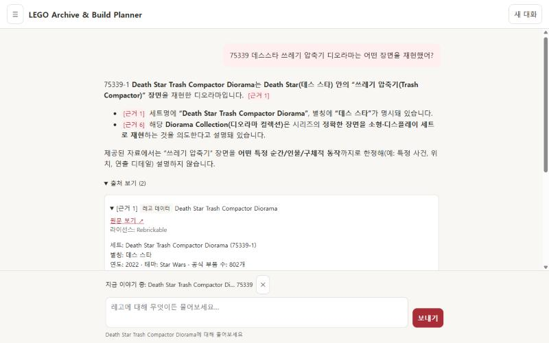
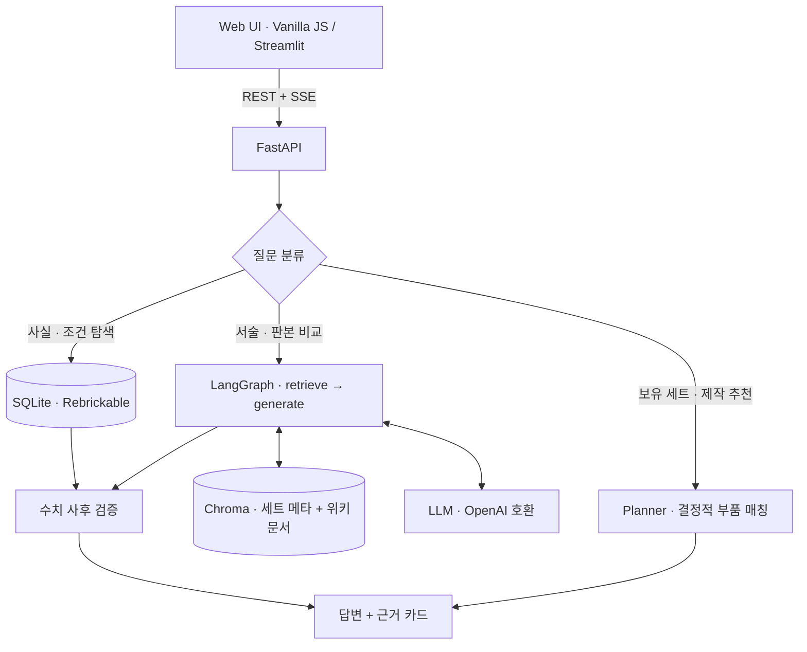

# Brickwise

> 레고 세트를 검색하고, 질문하고, **내가 가진 부품으로 만들 수 있는 세트**를 추천받는 RAG 챗봇

     

<sub>SSAFY AI 코어 프로젝트 · 개인 · 2026.10 · LEGO Group과 무관한 비공식 팬 프로젝트입니다.</sub>



<br/>

## 핵심 성과

| 지표 | 결과 | 측정 조건 |
|---|---|---|
| 검색 Recall@5 | **0.65 → 0.875** | MMR 도입 전후, 검색 평가 40문항 |
| 답변 속 숫자 정확도 | **1/11 → 11/11** | 같은 모델의 LLM 단독 답변 대비, 대표 8문항 |
| RAG 전후 품질 점수 | **17 → 39점** (48점 만점) | 사실 정확성·근거 제시·모름 처리 3기준 |
| 자동화 테스트 | **1,404건 통과** | pytest, 데이터가 필요한 20건은 데이터 준비 후 실행 |

<sub>모든 수치는 직접 만든 평가셋 기준입니다. 원자료는 `eval/results/`, 분석은 [RAG 전후 비교](docs/04_RAG전후비교.md)에 있습니다.</sub>

<br/>

## 주요 기능

- **근거 기반 답변** — 세트 메타데이터(Rebrickable)와 위키백과(한·영) 문서에서 근거를 찾아 답하고, 답변에 `[근거 N]`과 원문 링크·라이선스를 붙입니다.
- **숫자는 DB에서만** — 부품 수·연도·미니피그 수는 LLM이 아니라 SQL 결과에서 가져오고, 답변을 만든 뒤 근거에 없는 숫자를 지웁니다.
- **보유 세트 기반 제작 추천** — 등록한 세트의 부품으로 `(부품 번호, 색상)` 기준 부족 수량을 계산하고, 부족이 적은 세트를 추천합니다. 색상 무시 모드도 지원합니다.
- **대화형 조건 탐색** — "루크가 들어 있는 엑스윙 → 그중 2021년 → 첫 번째 건 부품이 몇 개야?"처럼 이어지는 질문을 이전 결과 기준으로 해석합니다.
- **질문 시점 문서 수집** — 근거가 부족하면 검색어 추출 → 위키 검색 → 후보 선별 → 수집·색인을 실행하고, 한 번 수집한 문서는 캐시합니다.

<br/>

## 아키텍처



<br/>

## 기술 스택

| 영역 | 사용 기술 |
|---|---|
| RAG | LangGraph, LangChain, ChromaDB, OpenAI 호환 LLM·임베딩 |
| Backend | FastAPI (REST + SSE), Pydantic, SQLite |
| Frontend | Vanilla HTML/CSS/JS, Streamlit |
| 데이터 | Rebrickable CSV 12종, 위키백과 API (CC BY-SA 4.0) |
| 품질 | pytest 1,404건, 자체 평가셋 (검색 40문항, RAG 비교 8문항, 대화 시나리오) |

<br/>

## 내 역할

개인 프로젝트이며, **AI 코딩 도구를 개발자로 두고 저는 PM을 맡았습니다.**

- **제가 한 일**: 요구사항 해석, 설계 결정 18건([ADR](docs/pm/decisions.md)), 작업지시서 28건 작성과 결과 검토, 평가셋 설계와 채점, 개선 방향 결정
- **AI 도구가 한 일**: 작업지시서에 따른 코드 구현 (Claude Code · Codex)
- 작업지시서와 검토 기록은 [`docs/pm/`](docs/pm/)에 그대로 남아 있습니다.

<br/>

## 기술적 의사결정

### 1. LLM이 숫자를 지어낸다 → 숫자는 DB에서만 가져오고 사후 검증

- **문제**: RAG 없이 물었을 때 LLM은 숫자 11개 중 **4개를 틀린 값**으로 답했습니다(출시 연도, 미니피그 수 등).
- **결정**: 숫자는 SQL 결과를 DB 근거 카드로 만들어 넘기고, 답변 생성 뒤 답변 속 숫자를 근거와 대조해 근거 없는 숫자를 지웁니다.
- **결과**: 숫자 정확도 **11/11**. 데이터 출처끼리 값이 다를 때(공식 부품 수 1,328 vs 부품 목록 집계 1,351)는 숨기지 않고 경고로 보여 줍니다.

### 2. 검색 Recall이 0.65에서 멈췄다 → MMR + 질문 원문 질의

- **문제**: 유사도 검색은 후보가 한 문서에 몰렸고, 영어 확장 검색어가 한국어 문서를 밀어냈습니다.
- **결정**: MMR(fetch_k 40, λ 0.7)로 다양성을 확보하고 질문 원문으로 질의합니다. 26개 설정을 같은 40문항으로 비교해 골랐습니다.
- **결과**: Recall@5 **0.650 → 0.875** (26 → 35/40), 한국어 문서만 보면 0.54 → 0.92.

### 3. 구조화 출력이 흔들린다 → 실측으로 방식 선택

- **문제**: 구조화 출력 방식을 비교해 보니 function calling·json_schema에서는 질문 분류 결과가 흔들렸습니다.
- **결정**: 150회 실측으로 비교해 오분류가 가장 적은 `json_mode`를 택하고, 프롬프트에 키와 예시를 명시한 뒤 Pydantic으로 검증합니다.
- **결과**: 분류기 출력이 항상 정해진 스키마를 통과한 값만 다음 단계로 넘어갑니다.

### 알려진 한계

- 질문 분류기가 일부 서술형·답 없는 질문을 사실 질의로 분류합니다(8문항 중 2건). 사례와 원인은 [RAG 전후 비교](docs/04_RAG전후비교.md)에 있습니다.
- 데이터 범위는 스타워즈 테마 2015년 이후 378세트입니다. 범위는 `config/settings.yaml`의 `scope`에서 바꿀 수 있습니다.

<br/>

## 실행 방법

> 저장소에는 수집 데이터와 벡터 색인이 없습니다. 아래 순서대로 실행하면 직접 만들어집니다. (Windows, Python 3.12)

```powershell
python -m venv .venv
.venv\Scripts\python -m pip install -r requirements.txt
copy .env.example .env                                # GMS_KEY(OpenAI 호환 API 키), WIKI_CONTACT 입력
.venv\Scripts\python scripts\load_rebrickable.py      # Rebrickable CSV → SQLite
.venv\Scripts\python scripts\index_items.py           # 세트 메타 색인
.venv\Scripts\python scripts\index_docs.py            # 위키 문서 색인
.venv\Scripts\uvicorn server.main:app --port 8000     # 웹 UI → http://127.0.0.1:8000
.venv\Scripts\python -m pytest -q                     # 테스트
```

<br/>

## 더 보기

| 문서 | 내용 |
|---|---|
| [상세 문서](docs/details.md) | 기능 명세, 데이터 준비 절차, 데이터 출처와 이용 조건 |
| [RAG 파이프라인 설계](docs/02_RAG파이프라인설계.md) | 컬렉션 구조, 청킹, 프롬프트, 검색 실험 |
| [검증 결과](docs/03_검증결과.md) | 기능별 검증과 화면 캡처 |
| [RAG 전후 비교](docs/04_RAG전후비교.md) | 대표 8문항 채점표 |
| [설계 결정 기록](docs/pm/decisions.md) | ADR-001 ~ ADR-018 |
