# 검증 결과 — LEGO Archive & Build Planner

> 결과 표기: 통과 / 실패 / 미확인. 증명 화면은 `docs/screenshots/`(아래 §3 캡처 목록의 파일 이름)에 둔다.
> 검증일: 2026-10-23 · 커밋 기준 `main` · 실행 환경 Windows 11, Python 3.12, GMS gpt-5.4-nano / text-embedding-3-small

## 1. 요구사항 대조표
| 번호 | 확인 방법 | 결과 | 증빙 |
|---|---|---|---|
| F2001 | 범위 세트 378건 적재, 세트 1건 = 색인 텍스트 1개, 부품 집계로 `num_parts` 331/332 재현 | 통과 | `tests/test_data_integrity.py`, S-01 |
| F2002 | `set_meta` 378청크, 재색인 후에도 378(upsert) | 통과 | `tests/test_index_items_offline.py`, S-01 |
| F2003 | P1 JSON 추출·파싱 실패 시 세트 이름 대체 | 통과 | `tests/test_collect_offline.py`, S-02 |
| F2004 | 질문 시점 수집 단계 표시, 같은 검색어 재요청 시 "이미 수집됨" | 통과 | S-02, S-03 |
| F2005 | 청크 1000/200(설정), ID `{scope}:{doc_id}:{seq}` 충돌 없음 | 통과 | `tests/test_chunking.py`, S-01 |
| F2006 | 메타 청크 항상 포함 + MMR 병합·중복 제거, Top-k 설정 반영 | 통과 | `tests/test_retrieve_offline.py`, `test_retrieval_defaults.py` |
| F2007 | 2노드 그래프 구조 출력, 근거 없으면 "확인되지 않음", 출처 유형 구분 | 통과 | `docs/screenshots/rag_graph.mmd`, S-04, RAG 전후 B-08 |
| F2008 | 답변 `[근거 N]`과 답변별 "출처 보기" 번호 일치, 인용 없으면 안내 | 통과 | S-04, S-05 |
| F2009 | 대상 A→B 변경 뒤 세트별 기록에 A 대화가 섞이지 않음 | 통과 | S-06, S-07, `tests/test_dialogue_store.py`, `test_chat_v2.py` |
| F2010 | 보유 세트 부족 부품 분석·추천·판본 비교 + DB 근거 | 통과 | S-08a, S-08b, S-09 |
| F2011 | 조건 탐색 결과에 조건 위반 세트 없음, 카드 선택 → 같은 대화에서 질문 | 통과 | S-10a, S-10b, 조건 탐색 10조건 위반 0(T-010) |
| F2012 | 단계별 진행 상태, 색인 0건·키 없음 안내 | 통과 | S-02a, S-11, S-16, `tests/test_status.py` |
| F2013 | HTML/CSS/JS 화면에서 질문·답변·근거 표시, 화면·서버 분리, OpenAPI | 통과 | S-00, S-04~S-10(웹), S-15(모바일), S-12(`/docs`) |
| F2014 | MMR vs 유사도: Recall@5 0.650 → 0.875 | 통과 | `docs/02` §6, `eval/results/2026-10-22_t017-pm-grid.md` |
| F2015 | RAG 전후 8문항: 단독 17점 / 서비스 39점 | 통과 | `docs/04_RAG전후비교.md` |
| F2016 | DB 근거 + 위키백과(한·영) 결합, 출처 유형 배지 | 통과 | S-05 |
| NF2001 | 경로별 응답 시간 측정(캐시 있음 사실 9ms~서술 6초, 처음 서술 15~26초) | 통과 | `eval/results/2026-10-22_latency-live*.md` |
| NF2002 | 같은 질문 재요청 시 위키 재검색 없음 | 통과 | S-03, `tests/test_collect_offline.py` |
| NF2003 | `.env`만 사용, 제출 zip 키 검사 통과 | 통과 | `scripts/build_submission.ps1` 실행 결과 |
| NF2004 | 오류 시 원인·조치 한 줄, 트레이스·키 비노출 | 통과 | `tests/test_server_*`(응답 본문 검사), S-11 |
| NF2005 | UI는 `services` 공개 함수만 import | 통과 | `tests/test_streamlit_app.py`, `test_server_api.py` 경계 검사 |
| NF2006 | UA 연락처·간격·재시도 | 통과 | `tests/test_collectors_offline.py` |
| NF2007 | README·근거 카드에 출처·라이선스 | 통과 | README, S-05 |

## 2. 테스트 결과표
| 테스트 | 입력 | 기대 결과 | 실제 결과 | 판정 |
|---|---|---|---|---|
| 단위·통합 테스트 | `pytest -q` | 전체 통과 | **1,386 passed** | 통과 |
| 웹 JS 테스트 | `node --test web/tests/*.test.mjs` | 전체 통과 | **38 pass** | 통과 |
| 라우팅 (PM 작성 40) | `eval/routing.jsonl` | ≥ 39 | **39/40** (RT-29: '크기'는 미지원 속성) | 통과 |
| 라우팅 확인 문항 (비공개 20) | `routing_holdout*.jsonl` | 과적합 확인 | **12/12, 8/8** | 통과 |
| 라우팅 기존 24 | `route_questions.jsonl` | 24/24 | **24/24** | 통과 |
| 검색 (섹션 Recall@5) | `eval/retrieval.jsonl` 40 | 기준선 0.65 이상 | **0.875 (35/40)** | 통과 |
| RAG 전후 비교 | `eval/rag_compare.jsonl` 8 | 서비스 우위 | 숫자 정확 **11/11 vs 1/11**, 점수 39 vs 17 | 통과 |
| 대표 대화 7단계 | `eval/dialogue_scenarios.jsonl` DS-01 × 3회 | 7단계 모두 통과 | **3/3** | 통과 |
| 다턴 시나리오 전체 | DS-01~07 × 3회 | ≥ 90% | 1차 15/21 → 수정 후 **18/21 (86%)** | 부분 통과 — DS-06 영어 대화만 실패(아래) |
| 보유 등록 멱등 | 같은 request_id 3회 | 1회만 반영 | 1회 반영, 같은 턴 재전송 | 통과 |

- 다턴 시나리오 1차 실패 원인과 조치(T-026 피드백 1차): ① 영어 탐색·정제 표현 미인식 → 단서 추가 ② 연도 `2021`을 세트 번호로 오인(스타워즈 무관 세트로 답함) → 연도 문맥·범위 세트 조건으로 차단 ③ "다시 추천해줘" 미인식 → 추천 후속 규칙. 수정 후 DS-01~05·07은 3회 모두 통과.
- 남은 한계: DS-06 영어 "Find X-wing sets that include Luke"에서 조건 추출이 '루크 미니피그' 조건을 만들지 못해 X-wing 전체 12건이 나오고 이후 단계가 이어지지 않음(엉뚱한 세트로 답하지는 않음). 영어 조건 추출 보강은 로드맵 후속.

## 3. 4장 확인 항목 (화면 캡처)
> 2026-10-23 재촬영(T-027 대화 중심 웹 UI) · 웹 `http://localhost:8010`(1280px, S-15만 375px), Streamlit `http://127.0.0.1:8501`(S-13) · 실제 GMS 키 사용
> S-01은 셀프 점검 후 재촬영(테스트용 컬렉션 정리 뒤 3,529청크). S-12·S-13은 화면 변경이 없어 이전 촬영(커밋 `9277f9b`)을 유지한다. 웹 캡처는 운영 데이터 복사본(빈 보유 목록)으로 촬영해 운영 `data/`를 바꾸지 않았다.

| 캡처 | 파일 | 확인 항목 | 재현 질문 |
|---|---|---|---|
| S-00 | [S00_home.jpg](screenshots/S00_home.jpg) | 4.5 F2013 첫 화면(T-027): "어떤 레고를 찾고 있나요?" + 질문 예시 4개, 하단 고정 입력창 | 접속 직후 |
| S-01 | [S01_index_status.jpg](screenshots/S01_index_status.jpg) | 4.1 데이터·색인 상태: 세트 378, 메타 색인 378, 외부 문서 3,529청크, 키 설정, 질문 가능 | `GET /api/status` |
| S-02 | [S02_progress_collect.jpg](screenshots/S02_progress_collect.jpg) | 4.2 질문 시점 수집: 처리 과정(분류→검색어 추출→문서 수집→검색→생성→검증)과 수집 근거로 답변. 진행 중 화면은 [S02a](screenshots/S02a_progress_live.jpg)("찾는 중… (문서 수집)") | "75339 데스스타 쓰레기 압축기 디오라마는 어떤 장면을 재현했어?" |
| S-03 | [S03_cache_hit.jpg](screenshots/S03_cache_hit.jpg) | 4.2 수집 캐시: 같은 질문 재요청 시 "문서 수집: 이미 수집됨" (NF2002) | 같은 질문 한 번 더 |
| S-04 | [S04_answer_citation.jpg](screenshots/S04_answer_citation.jpg) | 4.3 답변의 [근거 1]·[근거 6]과 답변 아래 "출처 보기 (2)" 카드 일치, 원문 링크·라이선스 | [근거 1] 클릭 |
| S-05 | [S05_source_types.jpg](screenshots/S05_source_types.jpg) | 4.3 메타데이터(레고 데이터·Rebrickable)와 외부 문서(위키백과·CC BY-SA 4.0) 구분 — F2016, [근거 6] 강조 | [근거 6] 클릭 |
| S-06 | [S06_history_A.jpg](screenshots/S06_history_A.jpg) | 4.4 항목별 대화 분리 ①: ☰ 메뉴 "이 세트 이야기 기록" — 75301-1 질문만(목록만 나온 첫 턴 제외) | S-10b 후 "부품이 몇 개야?" |
| S-07 | [S07_history_B.jpg](screenshots/S07_history_B.jpg) | 4.4 항목별 대화 분리 ②: 대상을 75192-1로 바꾼 뒤 기록에 75301-1 대화가 섞이지 않음 | "75192 부품 몇 개야?" → "이 세트 미니피그는 누가 있어?" |
| S-08a | [S08a_register.jpg](screenshots/S08a_register.jpg) | 4.4 대화 기반 보유 등록: "보유 0개 → 1개" | "그거 하나 보유 목록에 등록해줘" |
| S-08b | [S08b_build_recommend.jpg](screenshots/S08b_build_recommend.jpg) | 4.4 도메인 특화 기능: 보유 부품 기반 추천 카드, "부품 86개 더 필요" 배지 + DB 근거 | "내 부품으로 다른 건 뭐 만들 수 있어?" |
| S-09 | [S09_ignore_color.jpg](screenshots/S09_ignore_color.jpg) | 4.4 특화 기능 모드 비교: 색상 무시 77개 / 정확 일치 86개, 부족 부품 상세 표 | "첫 번째 건 색상은 무시하면 얼마나 부족해?" |
| S-10a | [S10a_condition_search.jpg](screenshots/S10a_condition_search.jpg) | 4.4 조건 기반 탐색: 조건에 맞는 12개 카드(번호·연도·부품 수, [자세히 물어보기]·[갖고 있어요]) | 질문 예시 "루크가 들어 있는 엑스윙 찾아줘" 클릭 |
| S-10b | [S10b_condition_refine.jpg](screenshots/S10b_condition_refine.jpg) | 4.4 이전 결과 정제와 선택: "그중 2021년" → 75301-1을 "지금 이야기 중"으로 선택(F2011) | "그중 2021년에 나온 건?" |
| S-11 | [S11_no_key.jpg](screenshots/S11_no_key.jpg) | 4.4 키 없음 안내: "준비 필요" 안내 띠, 예시·전송 비활성(F2012) | GMS_KEY를 비운 채 서버 실행 |
| S-12 | [S12_openapi.jpg](screenshots/S12_openapi.jpg) | 4.5 F2013 요청·응답 형식(OpenAPI) | `/docs` |
| S-13 | [S13_streamlit.jpg](screenshots/S13_streamlit.jpg) | 4.5 필수 UI(Streamlit)에서 같은 질문 → 같은 결과(웹과 비교) | Streamlit에서 S-10a 질문 |
| S-14 | [S14_no_citation.jpg](screenshots/S14_no_citation.jpg) | 4.3 인용 근거 0건: "출처 보기 (0)" → "답변에 인용된 근거가 없습니다" | "그거 가지고 싶어" |
| S-15 | [S15_mobile.jpg](screenshots/S15_mobile.jpg) | 4.5 F2013 모바일(375px): 가로 스크롤 없음, 대상 칩·입력창 하단 고정 | 375×812에서 S-02 대화 |
| S-16 | [S16_no_index.jpg](screenshots/S16_no_index.jpg) | 4.4 색인 없음 안내: 항목·외부 문서 색인 0건 "준비 필요" + 조치, 전송 비활성(F2012) | 빈 Chroma 경로로 서버 실행 |

- 2노드 그래프 증빙: [rag_graph.mmd](screenshots/rag_graph.mmd) (`scripts/print_graph.py` 출력)

### 캡처 이미지

**S-00** — 4.5 F2013 첫 화면(T-027): "어떤 레고를 찾고 있나요?" + 질문 예시 4개, 하단 고정 입력창

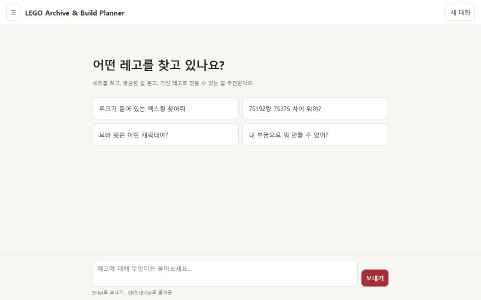

**S-01** — 4.1 데이터·색인 상태: 세트 378, 메타 색인 378, 외부 문서 3,529청크, 키 설정, 질문 가능

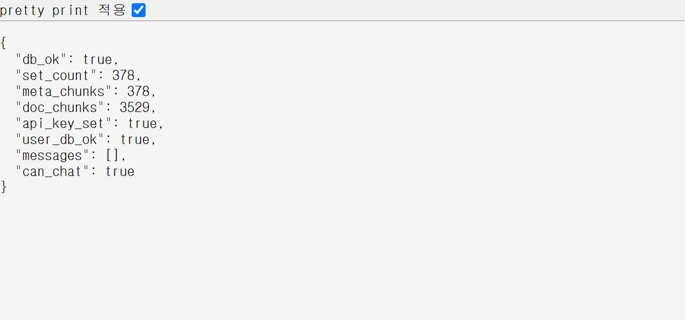

**S-02** — 4.2 질문 시점 수집: 처리 과정(분류→검색어 추출→문서 수집→검색→생성→검증)과 수집 근거로 답변. 진행 중 화면은 아래 S-02a("찾는 중… (문서 수집)")

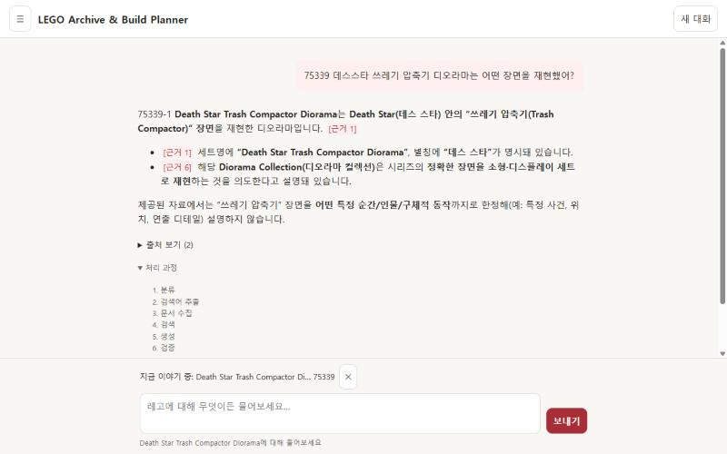

**S-02a** — 4.2 진행 중 표시: "찾는 중… (문서 수집)", 처리 중 입력 비활성

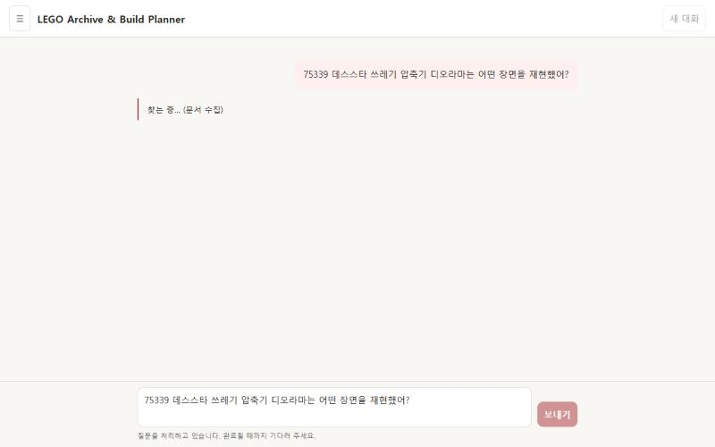

**S-03** — 4.2 수집 캐시: 같은 질문 재요청 시 "문서 수집: 이미 수집됨" (NF2002)

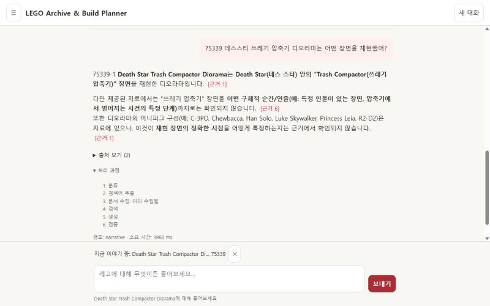

**S-04** — 4.3 답변의 [근거 1]·[근거 6]과 답변 아래 "출처 보기 (2)" 카드 일치, 원문 링크·라이선스

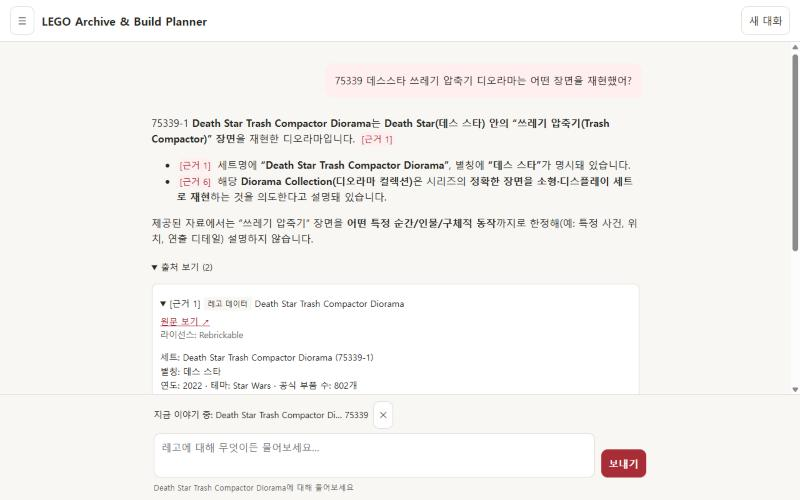

**S-05** — 4.3 메타데이터(레고 데이터·Rebrickable)와 외부 문서(위키백과·CC BY-SA 4.0) 구분 — F2016, [근거 6] 강조

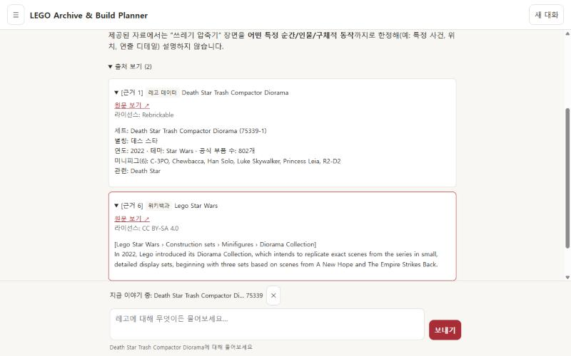

**S-06** — 4.4 항목별 대화 분리 ①: ☰ 메뉴 "이 세트 이야기 기록" — 75301-1 질문만(목록만 나온 첫 턴 제외)

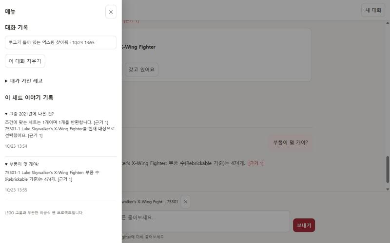

**S-07** — 4.4 항목별 대화 분리 ②: 대상을 75192-1로 바꾼 뒤 기록에 75301-1 대화가 섞이지 않음

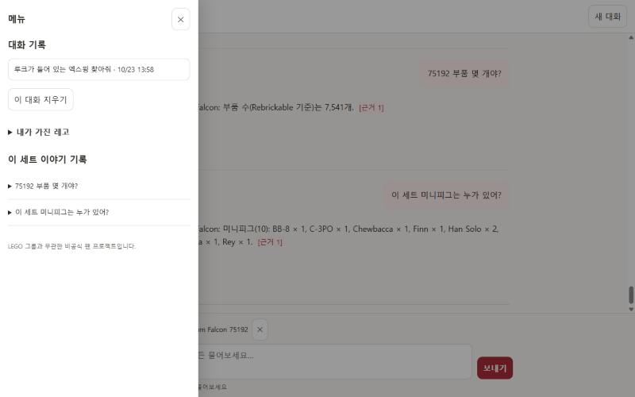

**S-08a** — 4.4 대화 기반 보유 등록: "보유 0개 → 1개"

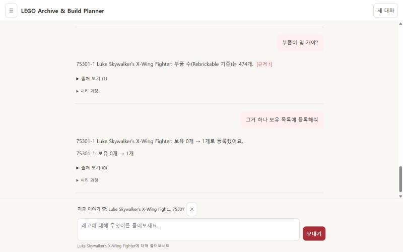

**S-08b** — 4.4 도메인 특화 기능: 보유 부품 기반 추천 카드, "부품 86개 더 필요" 배지 + DB 근거

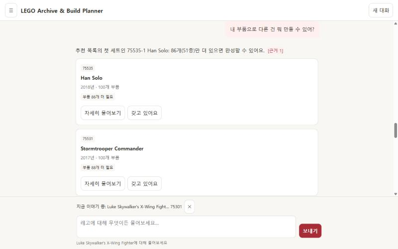

**S-09** — 4.4 특화 기능 모드 비교: 색상 무시 77개 / 정확 일치 86개, 부족 부품 상세 표

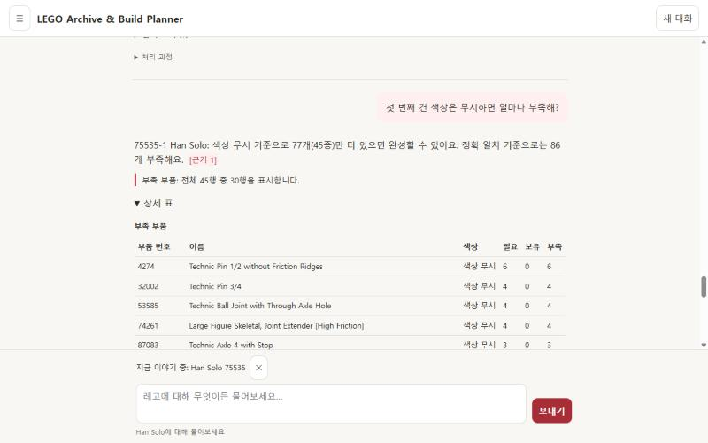

**S-10a** — 4.4 조건 기반 탐색: 조건에 맞는 12개 카드(번호·연도·부품 수, [자세히 물어보기]·[갖고 있어요])

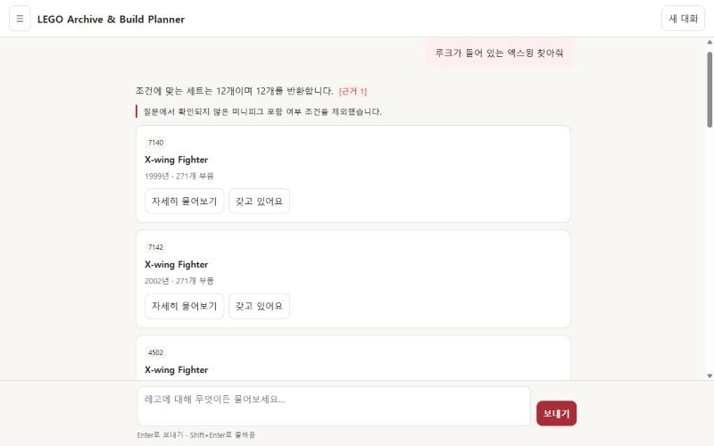

**S-10b** — 4.4 이전 결과 정제와 선택: "그중 2021년" → 75301-1을 "지금 이야기 중"으로 선택(F2011)

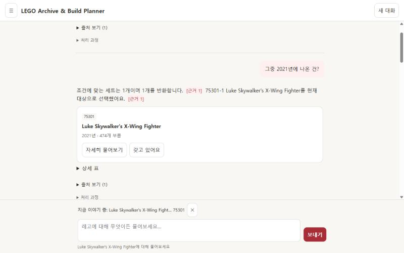

**S-11** — 4.4 키 없음 안내: "준비 필요" 안내 띠, 예시·전송 비활성(F2012)

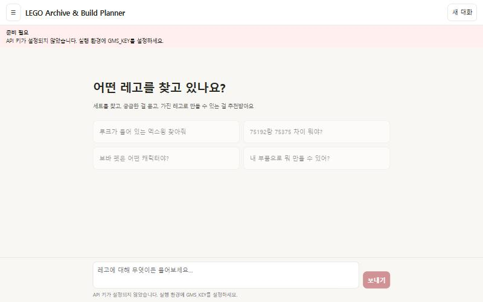

**S-12** — 4.5 F2013 요청·응답 형식(OpenAPI)

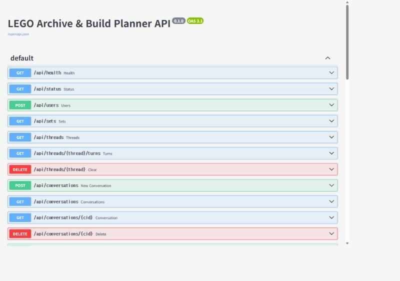

**S-13** — 4.5 필수 UI(Streamlit)에서 같은 질문 → 같은 결과(웹과 비교)

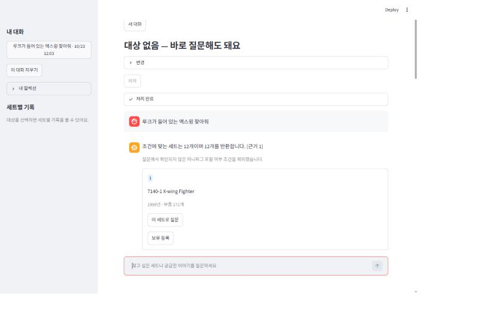

**S-14** — 4.3 인용 근거 0건: "출처 보기 (0)" → "답변에 인용된 근거가 없습니다"

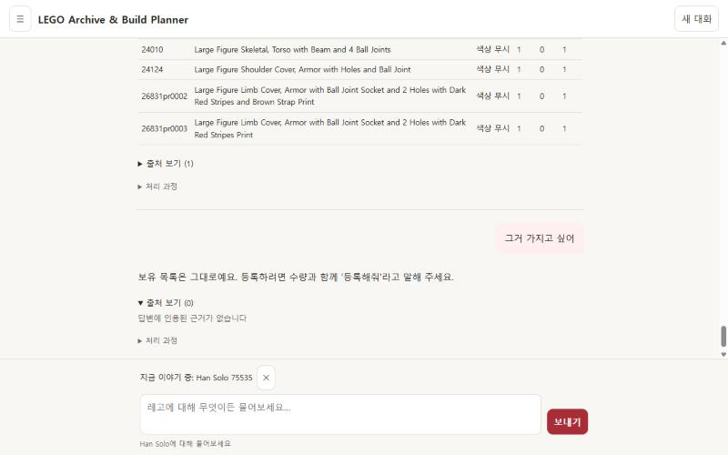

**S-15** — 4.5 F2013 모바일(375px): 가로 스크롤 없음, 대상 칩·입력창 하단 고정

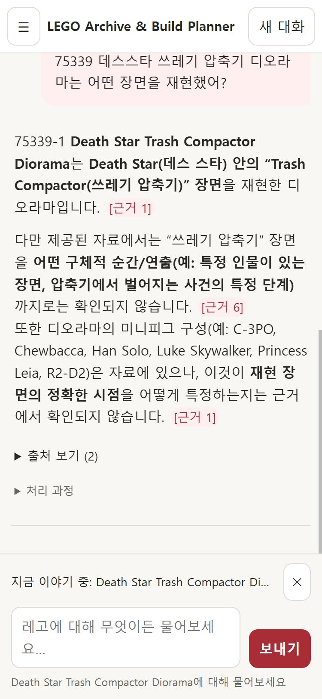

**S-16** — 4.4 색인 없음 안내: 항목·외부 문서 색인 0건 "준비 필요" + 조치, 전송 비활성(F2012)

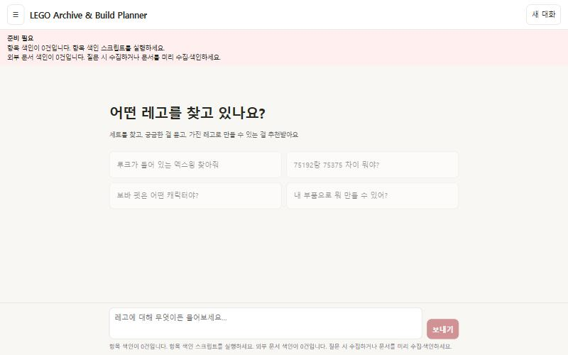

## 4. 셀프 체크리스트 / 상호 체크리스트
> 공식 양식: [06_셀프·상호_체크리스트.xlsx](06_셀프·상호_체크리스트.xlsx) — 27개 항목의 결과·증빙·비고를 기입했다. 아래 표는 요약이다.

| 항목 | 셀프 | 상호 |
|---|---|---|
| 필수 기능 F2001~F2012 동작 | 통과 | |
| 근거 번호·근거 목록 일치, 인용 0건 안내 | 통과 | |
| 항목을 바꿔도 이전 대화가 섞이지 않음 | 통과 | |
| 조건 탐색 결과에 조건 위반 항목 없음 | 통과 | |
| 진행 상태·키 없음·색인 없음 안내 | 통과 | |
| 화면에 키·프롬프트·트레이스 비노출 | 통과 | |
| 심화 F2013 화면에서 질문·답변·근거 표시 | 통과 | |
| 심화 결과와 필수 UI(Streamlit) 비교 | 통과 | |

## 5. 제출 전 점검 목록
- [x] 필수 기능 F2001~F2012가 모두 동작한다
- [x] 선택한 심화 기능(F2013)이 동작하고 필수 기능(Streamlit) 결과와 비교되어 있다 (F2014~F2016 추가)
- [x] 증명용 스크린샷을 모두 첨부했다 (§3, 20장)
- [x] 요구사항 정의서 · RAG 파이프라인 설계문서 · 소스코드 · README.md를 모두 포함했다
- [x] 검증 결과(요구사항 대조표, 테스트 결과표, 셀프·상호 체크리스트)를 포함했다
