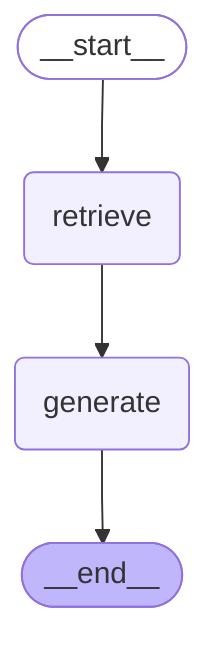

# T-008 RAG 그래프 (retrieve → generate) · 근거 카드 · 인용 필터

- 상태: 완료
- 사용자 검토 (2026-10-21) 결과
  - ② 다양성은 **결정적 상한** (MMR은 M6에서 비교)
  - ③ 수집은 **retrieve 노드 안**에서 호출
  - ④ P3는 **강화 지시**
  - ⑥ 근거 번호는 **원래 번호 유지**
  - ①·⑤는 초안대로
- 관련 요구사항
  - F2006: 선택 항목 메타 청크를 항상 포함, 두 컬렉션 병합·중복 제거, Top-k는 설정값
  - F2007: LangGraph retrieve·generate 두 노드, 검색된 문서만 사용, 근거 없으면 "확인되지 않음", 출처 유형 구분
  - F2008: 주장마다 `[근거 N]`, 실제로 인용한 근거만 제목·원문 출처와 함께 표시, 인용이 없으면 안내
  - F2012: 진행 상태 표시
  - NF2004: 내부 정보 비노출
- WBS: 4.8, 4.10, 4.11 / ADR-006(2노드 + 카드 주입)·ADR-008 결정 5·7·8
- 선행 작업: T-004(LLM·구조화 호출), T-005(`set_meta`), T-006(`set_docs`), T-007(`collect_for_question`, `en_terms`)

## 목표
세트를 선택하고 질문하면 다음 흐름으로 답한다.
1. **retrieve 노드**: 질문 시점 수집(T-007) → 근거 검색(메타 + 문서) → 근거 카드 번호 부여
2. **generate 노드**: P3로 근거 기반 답변 생성
3. 인용 필터: 실제로 인용한 근거만 남긴다

과제 검증 4.3의 "LangGraph가 retrieve와 generate 두 노드로 구성"을 그래프 출력(mermaid)으로 증빙한다.

## 실측 근거 (PM, 2026-10-21)
### 검색 구성 — 필터 `{"$or": [{"sets": {"$contains": set}}, {"scope": "series"}]}`, top-10
| 세트 · 질문 | 원 질문만 | 원 질문 + 영어 확장(P1 `en_terms` 상당) |
|---|---|---|
| 75257-1 "누가 디자인했어?" | 시리즈 8 · 기체 2 | **기체 10 (Falcon)** |
| 75301-1 "어떤 전투에 참여?" | 캐릭터 6 · 시리즈 3 · 기체 1 | 질문 시점(Battle of Yavin) 5 · 기체 4 · 캐릭터 1 |
| 75076-1 "건쉽 영화 속 역할" | 시리즈 8 · 목록 2 | **목록 10 (한 문서가 전부 차지)** |
| 75357-1 "고스트호 작품" | 시리즈 8 · 목록 2 | 목록 9 · 시리즈 1 |
| 75283-1 "AAT 진영" | **시리즈 10** | **시리즈 10** (AAT 직접 문서 없음) |

→ ① 영어 확장이 결정적이다. ② 한 문서(목록·시리즈)가 근거를 독점하는 일이 잦다. ③ 근거가 없는 질문이 있다.

### P3 시험 (gpt-5.4-nano, 근거 카드 6개 = 세트 메타 + 문서 5)
| 질문 | 지연 | 입력/출력 토큰 | 결과 |
|---|---|---|---|
| 75257-1 디자이너 | 1.1초 | 1,088 / 48 | "Joe Johnston이 1977년 영화를 위해 디자인" [근거 5] — 정확 |
| 75283-1 AAT 진영 | 1.7초 | 1,533 / 184 | 근거가 직접 답하지 않는데 "공화국/분리주의자 측"으로 **애매하게 추론**하고 시리즈 문서의 세트 목록을 근거로 인용 — **엄격성 부족** |

## 역할 분담
- **Codex**: 코드와 오프라인 테스트(가짜 LLM·FakeEmbedding·임시 Chroma)를 작성한다. 네트워크·GMS 호출은 실행하지 않는다. 작업 중 `.env`를 열람하지 않는다 (코드가 실행 시 로드하는 것은 정상).
- **PM**: 실데이터로 대표 질문 10개를 실행해 근거 구성·인용 정확도·지연을 측정하고, 그래프 구조 출력을 검증 자료로 저장한다.

## 범위
- 포함
  1. 근거 카드 모델 (`evidence.py`)
  2. retrieve 노드: 수집 호출, 질의 구성, 메타 카드 강제 포함, 문서 검색, 다양성 상한, 중복 제거, 번호 부여, 주입 카드(`injected_cards`) 병합
  3. P3 프롬프트(`p3-v1`)와 generate 노드
  4. 인용 파서·필터 (`citations.py`, 실습 골격 `cited_sources` 방식 재사용)
  5. LangGraph 그래프 조립과 mermaid 출력 스크립트
  6. 실행 CLI `scripts/ask.py`
- 제외
  - 질의 라우터·SQL 경로·planner 카드 생성 (M4)
  - 수치 사후 검증 (WBS 5.4, M4)
  - MMR·BM25·Rerank (M6)
  - UI, 대화 저장 (M5)

## 수정·생성할 파일
- `src/rag_service/rag/evidence.py`, `retrieve.py`, `generate.py`, `citations.py`, `graph.py`
- `src/rag_service/rag/prompts.py` — `p3_messages()`·`P3_PROMPT_VERSION` 추가만
- `scripts/ask.py`, `scripts/print_graph.py`
- `config/settings.yaml` — `retrieval` 섹션 보강
- `tests/test_citations.py`, `tests/test_retrieve_offline.py`, `tests/test_graph_offline.py`

## 설계 (검토 포인트 ①~⑥)

### ① 검색 질의 구성
- 질의 = 원 질문 + `" "` + P1 `en_terms`(T-007 `CollectResult.en_terms`, 최대 8개)
- P1이 실패하면 원 질문 + 세트 영문명으로 대신한다.
- 메타 카드는 검색하지 않고 `set_meta`에서 ID로 직접 가져온다 (F2006).

### ② 다양성 상한 (한 문서 독점 방지)
- 후보를 `top_k × retrieval.fetch_multiplier`(기본 4)만큼 가져온 뒤, 순서대로 훑으면서 다음 상한을 지켜 `top_k`(5)개를 고른다.
  - 같은 `doc_id` 최대 `retrieval.max_chunks_per_doc`개 (기본 2)
  - `scope=series` 최대 `retrieval.max_series_chunks`개 (기본 2)
  - `entity_kind=group`·`list`는 각각 최대 `retrieval.max_group_chunks`·`retrieval.max_list_chunks`개 (기본 2)
- 상한 때문에 5개를 못 채우면 그대로 둔다 (억지로 채우지 않음).
- 이 규칙은 MMR(F2014, M6)과는 별개인 결정적 규칙이다. M6에서 MMR과 비교한다.

### ③ 질문 시점 수집의 위치
- **retrieve 노드 안에서** `collect_for_question()`을 호출한다. 진행 이벤트(`on_event`)는 그래프 실행 인자로 받은 콜백에 그대로 전달한다.
  - 이유: 과제의 "retrieve·generate 2노드" 구조를 유지하면서 F2003·F2004 흐름을 질문마다 실행하기 위해서다 (ADR-006: 라우팅은 그래프 밖, 수집·검색은 retrieve).
- 수집이 `partial`이거나 실패해도 검색은 진행한다. `RagState.warnings`에 남긴다.

### ④ P3 근거 엄격성 (AAT 사례 대응)
- 지시 (p3-v1)
  - 근거에 있는 내용만 쓴다.
  - **근거가 질문에 직접 답하지 않으면 추론하거나 일반 지식으로 메우지 말고 "제공된 자료에서 확인되지 않습니다"라고 답한다.** 관련 사실이 일부 있으면 확인된 것과 확인되지 않은 것을 나눠 쓴다.
  - 주장마다 `[근거 N]`을 붙인다.
  - 숫자·세트 번호·연도는 근거에 있는 값만 쓴다.
  - 고유명사는 영어 원문을 병기한다.
  - 시리즈 문서의 세트 목록은 질문이 세트 목록을 묻지 않는 한 근거로 쓰지 않는다.
- 대화 맥락: 최근 `retrieval.history_turns`(4)턴을 함께 넘긴다. 대화 저장은 M5 범위이고, T-008에서는 CLI 인자로 받는다.
- 출력은 자유 텍스트다 (JSON 아님).

### ⑤ 근거 카드와 번호
- `Card(n, source_type, title, url, license, text, item_id, doc_id, chunk_id, score, lang, entity_kind, section_path)`
- `source_type`: `set_meta` | `db` | `wikipedia` | `brickipedia`
- 번호 순서: 주입 카드(DB·planner, M4) → 세트 메타 → 문서 카드(점수순)
- 중복 제거: 같은 `chunk_id`, 또는 정규화 텍스트 해시가 같은 청크 (같은 내용의 영·한 문서는 서로 다른 텍스트이므로 유지)
- LLM에 넘길 때 카드 형식: `[근거 N] (출처 유형 · 제목 › 섹션)\n본문`. URL·라이선스는 LLM에 넘기지 않고 화면용으로만 쓴다 (토큰 절약).
- 세트 메타 카드의 URL은 Rebrickable 세트 페이지 (`https://rebrickable.com/sets/{set_num}/`), 라이선스 표기는 "Rebrickable"이다.

### ⑥ 인용 필터 (F2008)
- 정규식 `\[근거\s*([\d,\s]+)\]`로 번호를 추출한다 (실습 골격 `cited_sources`와 같은 방식). `[근거 3, 5]`, `[근거3]`을 허용한다.
- 카드 범위 밖 번호는 표기를 그대로 두고 `warnings`에 기록하며, 화면 근거 목록에서는 뺀다.
- 결과
  - `used_cards`: 인용된 카드만, 번호순
  - `no_citation`: 인용 0개면 True → 화면에 "답변에 인용된 근거가 없습니다" 안내
- 답변 본문 재번호(1..k로 다시 매기기)는 하지 않는다. 화면 번호와 본문 번호를 같게 유지한다 (과제 4.3 "본문 근거 번호와 화면 근거 목록 일치").

## 설정 추가
```yaml
retrieval:
  top_k: 5                  # 기존
  fetch_multiplier: 4
  max_chunks_per_doc: 2
  max_series_chunks: 2
  max_group_chunks: 2
  max_list_chunks: 2
  history_turns: 4
  max_en_terms: 8
  p3_prompt_version: "p3-v1"
```

## 인터페이스 계약
```python
# rag/graph.py
class RagState(TypedDict, total=False):
    set_num: str; question: str; history: list[dict]
    injected_cards: list[Card]
    collect: CollectResult | None
    cards: list[Card]; answer: str
    used_cards: list[Card]; no_citation: bool
    warnings: list[str]; usage: dict; timings: dict
def build_graph(deps: RagDeps) -> CompiledStateGraph       # 노드 정확히 2개: "retrieve", "generate"
def ask(set_num, question, history=None, injected_cards=None, on_event=None, deps=None) -> RagState

# rag/citations.py
def parse_citations(answer: str) -> list[int]
def filter_cited(answer: str, cards: list[Card]) -> tuple[list[Card], bool, list[str]]   # (used, no_citation, warnings)
```

## 테스트 (네트워크 없이)
- 그래프: 노드 이름이 정확히 `retrieve`·`generate`이고 엣지가 START→retrieve→generate→END다. mermaid 문자열에 두 노드가 있다.
- retrieve
  - 메타 카드가 항상 포함된다 (검색 결과가 0이어도).
  - 다양성 상한: 같은 문서 3개 이상 후보 → 2개만, 시리즈 상한
  - 중복 제거, 번호 순서(주입 → 메타 → 문서)
  - P1 실패 시 대체 질의
  - 수집 partial 경고 전달
- generate: 가짜 모델에 넘긴 메시지에 카드 본문은 있고 URL·라이선스는 없다. 최근 4턴만 들어간다.
- 인용
  - `[근거 2]`, `[근거 3, 5]`, `[근거3]` 파싱
  - 범위 밖 번호 경고
  - 인용 0개 → `no_citation`
  - 본문 번호와 `used_cards` 번호 일치
- 진행 이벤트 순서: 수집 이벤트 → `retrieving` → `generating` → `done`

## 완료 기준 (DoD)
- [ ] `pytest -q` 전체 통과 (기존 286개 회귀 없음)
- [ ] `scripts/print_graph.py`가 mermaid를 출력하고 `docs/screenshots/rag_graph.mmd`에 저장한다
- [ ] `scripts/ask.py --help` 동작, 키가 없으면 종료 코드 2
- [ ] 새 의존성 없음 (`langgraph`는 이미 requirements에 있음), 네트워크·GMS 호출 없음

## PM 실측 계획
- 대표 질문 10개 (매핑 세트·미매핑 세트·근거 없는 질문·한국어/영어·후속 질문 포함)
  - 측정: 근거 구성(종류별), 인용 수, 인용 정확도(PM 판정), "확인되지 않음" 처리, 단계별 지연
- AAT 질문 재시험: p3-v1 엄격성 확인
- `print_graph.py` 결과를 과제 4.3 증빙으로 사용

## 검증 명령
```powershell
.venv\Scripts\python -m pytest -q --basetemp=<쓰기 가능한 경로>
.venv\Scripts\python scripts\print_graph.py
.venv\Scripts\python scripts\ask.py --help
```

---

## 결과 보고 (Codex 작성)
- 변경 파일:
  - 신규: `src/rag_service/rag/evidence.py`, `retrieve.py`, `generate.py`, `citations.py`, `graph.py`.
  - 추가만 수행: `src/rag_service/rag/prompts.py`의 `P3_PROMPT_VERSION`·`p3_messages()`, `config/settings.yaml`의 retrieval 설정 8개. 기존 함수·기존 설정값은 변경하지 않았다.
  - 신규 CLI: `scripts/ask.py`, `scripts/print_graph.py`.
  - 신규 테스트: `tests/test_citations.py`, `tests/test_retrieve_offline.py`, `tests/test_graph_offline.py` (35개).
  - DoD 명시 출력물: `docs/screenshots/rag_graph.mmd` (`print_graph.py` 기본 경로로 생성). 문서 본문은 이 결과 보고 섹션만 수정했다.
- 실행 명령과 결과:
  - AGENTS.md §8 환경 메모에 따라 대체 Python **3.12.14**와 기존 `.venv/Lib/site-packages`를 사용했다. `.venv` 인터프리터는 재시도하지 않았고, 의존성 설치·추가도 없다.
  - 아래 공통 환경과 표준입력 부트스트랩으로 검증했다. 실제 키는 값 출력 없이 제거했다. 감사 훅으로 네트워크 연결·주소 조회와 `.env` 열기를 차단하고, 검증 프로세스에서만 Chroma의 dotenv 소스를 빈 값으로 대체했다. 제품 코드의 실행 시 환경 로딩은 그대로 유지했다.

    ```powershell
    $env:PYTHONPATH='C:/ssafy/08.AI_core_PJT/.venv/Lib/site-packages;C:/ssafy/08.AI_core_PJT/src'
    $env:PYTHONDONTWRITEBYTECODE='1'
    $env:PYTHONIOENCODING='utf-8'
    $env:PYTHON_DOTENV_DISABLED='1'
    $env:ANONYMIZED_TELEMETRY='False'
    $env:LANGSMITH_TRACING='false'
    $env:LANGCHAIN_TRACING_V2='false'
    @'
    import os, sys
    os.environ.pop('GMS_KEY', None)
    def guard(event, args):
        if event in ('socket.connect', 'socket.getaddrinfo'):
            raise AssertionError('Network forbidden')
        if event == 'open' and isinstance(args[0], str) and args[0].replace('\\', '/').split('/')[-1] == '.env':
            raise AssertionError('.env forbidden')
    sys.addaudithook(guard)
    from pydantic_settings import DotEnvSettingsSource
    DotEnvSettingsSource._read_env_files = lambda self: {}
    import pytest
    raise SystemExit(pytest.main(['-q', '--basetemp=C:/ssafy/08.AI_core_PJT/.pytest_cache/t008-full']))
    '@ | & 'C:/Users/SSAFY/.cache/codex-runtimes/codex-primary-runtime/dependencies/python/python.exe' -
    ```

  - 집중 실행: 같은 부트스트랩에서 `pytest.main(['-q', 'tests/test_citations.py', 'tests/test_retrieve_offline.py', 'tests/test_graph_offline.py', '--basetemp=C:/ssafy/08.AI_core_PJT/.pytest_cache/t008-focused'])` → **35 passed in 8.03s**, 종료 코드 0.
  - 전체 실행: 위 명령 → **321 passed, 1 warning in 55.41s**, 종료 코드 0. 기존 286개와 신규 35개 모두 통과, 실패·skip 없음. 경고는 기존 `test_collect_offline.py::test_cli_success_serializes_result_offline`의 `WIKI_CONTACT` 누락에 따른 `MissingContact` 1건이다.
  - 동일 보호 환경에서 `runpy.run_path(..., run_name='__main__')`로 `scripts/print_graph.py` 실행 → 종료 코드 **0**, 기본 경로 `docs/screenshots/rag_graph.mmd` 저장. 테스트에서 출력 문자열과 저장 파일의 일치도 검증했다.
  - 동일 보호 환경에서 `scripts/ask.py --help` → 종료 코드 **0**; `scripts/ask.py --set-num 75076-1 --question 질문` (키 없음) → 종료 코드 **2**, `GMS_KEY가 설정되지 않았습니다. 환경변수에 키를 설정한 뒤 다시 실행하세요.` 출력. 별도 subprocess 테스트에서도 동일 종료 코드를 확인했다.
  - `git diff --check` → 종료 코드 **0**. 네트워크·GMS 호출, `.env` 열람·출력, git commit·push·branch 작업 없음.
- 설계 판단과 이유:
  - `RagDeps`로 모델·메타/문서 컬렉션·수집 함수를 주입한다. 기본 실행은 기존 팩토리와 `collect_for_question`을 조합하며, 그래프 노드는 정확히 `retrieve`, `generate` 두 개다.
  - 콜백은 실행 config로 받아 기존 수집 함수에 그대로 전달한다. 따라서 기존 수집 완료 `done` 이벤트도 보존되고, 이후 `retrieving → generating → done`이 발생한다. 그래프 밖으로 수집을 이동하지 않았다.
  - 원 질문과 설정 개수 이내 영어 확장어를 합친다. 확장어가 없으면 직접 조회한 메타의 세트 영문명을 사용한다. 수집 partial·일반 실패 시 경고를 남기고 검색을 계속한다. 키 누락은 기존 계약대로 전파해 CLI에서 종료 코드 2로 처리한다.
  - Chroma 점수는 거리이므로 오름차순으로 후보를 처리한다. 문서·시리즈·group·list 상한과 중복 제거를 적용하며 부족한 개수는 보충하지 않는다. 테스트에서 실제 임시 Chroma의 `$contains`·시리즈 필터와 청크 ID 보존을 검증했다.
  - 번호는 주입 → 메타 → 문서 순서다. 필수 메타와 겹치는 주입 카드는 제외하고 ID로 읽은 메타 원본을 보존한다. 텍스트 중복은 NFKC·공백 정규화 후 해시로 판정하며, 입력 카드를 변경하지 않는다.
  - 이력은 `question/answer` 턴 목록과 `role/content` 메시지 목록을 지원한다. 사용자 질문부터 한 턴으로 묶어 최근 설정 턴만 P3에 전달한다. URL·라이선스 필드는 생성 메시지에서 제외하고 표시용 카드에 유지한다.
  - 근거가 전혀 없으면 모델을 호출하지 않고 확인 불가를 반환한다. 생성 실패는 설정된 재시도 후 안전한 안내로 바꾼다. 실제 유효한 인용만 원래 번호로 표시하고, 범위 밖 인용은 본문을 고치지 않고 경고한다. 유효한 인용이 없으면 `no_citation=True`와 CLI 안내를 제공한다.
- 남은 이슈 / PM 확인 필요:
  - PM 환경의 지정 `.venv`로 DoD 재검증이 필요하다. 실제 GMS 답변 품질·지연·AAT 사례의 P3 엄격성은 역할 분담에 따라 실행하지 않았다. 대표 질문 10개 실측은 PM 확인 사항이다.
  - 메타 색인 자체가 없을 때는 카드를 지어내지 않고 `index_items.py` 실행 경고를 반환한다. 정상 색인이 존재하면 외부 문서 검색 결과가 0개여도 메타를 포함한다.
  - 수치 사후 검증·MMR·라우터·UI·대화 저장은 이번 범위에서 구현하지 않았다.

`scripts/print_graph.py` 표준 출력 원문:



## PM 실측 결과
- 그래프 구조 (`print_graph.py` → `docs/screenshots/rag_graph.mmd`): `__start__ → retrieve → generate → __end__`, **노드 2개** (과제 4.3 증빙)
- 대표 질문 10개 (`ask.py`, 실제 GMS)

  | # | 세트 · 질문 | 인용 근거 | 결과 판정 (PM) | retrieve / generate |
  |---|---|---|---|---|
  | 1 | 75257-1 "이 기체는 누가 디자인했어?" | 메타 1 + 기체 1 | △ "레고 세트인지 영화 속 기체인지 불명확"하다며 머뭇거린 뒤 디자인 변경 내용 제시 | 0.9 / 3.5초 |
  | 2 | 75257-1 "Who designed this ship?" | 메타 1 + 기체 1 | ○ George Lucas(변경 요청) · Joe Johnston(재디자인) | 8.1 / 2.1초 |
  | 3 | 75301-1 "어떤 전투에 참여?" | 기체 1 + 캐릭터 1 | ○ Battle of Yavin | 0.8 / 1.4초 |
  | 4 | 75076-1 "건쉽 영화 속 역할" | 메타 1 + 목록 1 | ○ 확인된 것(Attack of the Clones·Revenge of the Sith 등장, 클론 수송)과 미확인을 구분 | 0.9 / 2.1초 |
  | 5 | 75357-1 "고스트호 작품" | 목록 2 | ○ Star Wars Rebels | 1.0 / 2.1초 |
  | 6 | 75283-1 "AAT 진영" | 시리즈 1 | ○ **"확인되지 않음"** (p3-v1 엄격성 효과, 초안 시험의 추론 사례 해소) | 0.6 / 1.9초 |
  | 7 | 75192-1 "부품 수" | 메타 1 | ○ 7,541개 | 5.5 / 1.0초 |
  | 8 | 75257-1 "미니피그" | 메타 1 | ○ 6명 목록 (T-005 짧은 이름) | 14.9 / 1.2초 |
  | 9 | 75257-1 "최고 속도" | 기체 2 | ○ "확인되지 않음" + Kessel Run 관련 사실 구분 | 4.9 / 2.0초 |
  | 10 | 75301-1 후속 "그 전투는 어느 행성 근처?" (이력 1턴) | 질문 시점 문서 1 | ○ Yavin 궤도 · Yavin 4 (대화 맥락 동작) | 10.9 / 1.2초 |

- 요약
  - 10/10 인용이 있고, 본문 번호와 근거 목록 번호가 일치한다.
  - 판정 ○ 9 · △ 1.
  - "확인되지 않음" 처리 2건(6·9)이 정상이다.
  - 전체 지연은 1.8~16.1초로, 새 질문은 P1·수집 때문에 길다. 캐시된 질문은 retrieve 약 1초다.
  - P3 입력 토큰은 729~1,498이다.
- 남은 품질 이슈
  1. Q1: 엄격성 강화의 부작용으로 지시어("이 기체")를 해석하지 못하고 머뭇거렸다 → **p3-v2 후속**: "질문의 '이 기체/이 세트'는 선택 세트가 묘사하는 대상으로 해석한다. 레고 세트 자체 정보(설계자 등)는 근거에 있을 때만 답한다."
  2. Q6: 한국어 시리즈 문서의 세트 목록 청크가 상한(시리즈 ≤2) 안에서 여전히 근거로 들어온다 → M6에서 목록형 섹션 제외 또는 점수 임계값을 검토한다.

## PM 리뷰
- 판정: **승인** (2026-10-21, 피드백 없음)
- PM 재검증 (`.venv`): pytest **321 passed** (경고 1: 기존 연락처 안내), `print_graph.py` 2노드 출력, `ask.py --help` 동작.
- 코드 리뷰
  - 다양성 상한은 후보를 순서대로 훑으며 문서당·유형별 상한을 적용한다.
  - 메타 카드는 ID로 강제 포함한다.
  - 수집 실패는 경고로 남기고 검색은 계속한다.
  - LLM에는 카드의 URL·라이선스를 넘기지 않는다.
  - 인용 번호는 원래 번호를 유지한다.
- 후속: p3-v2 (지시어 해석), 시리즈 목록 청크 처리 (M6), 수치 사후 검증과 라우터 (M4)
